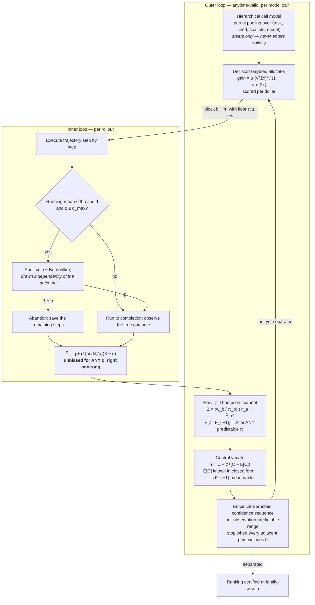
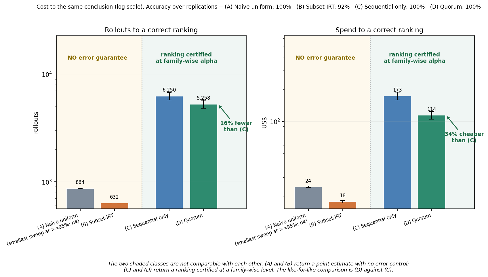
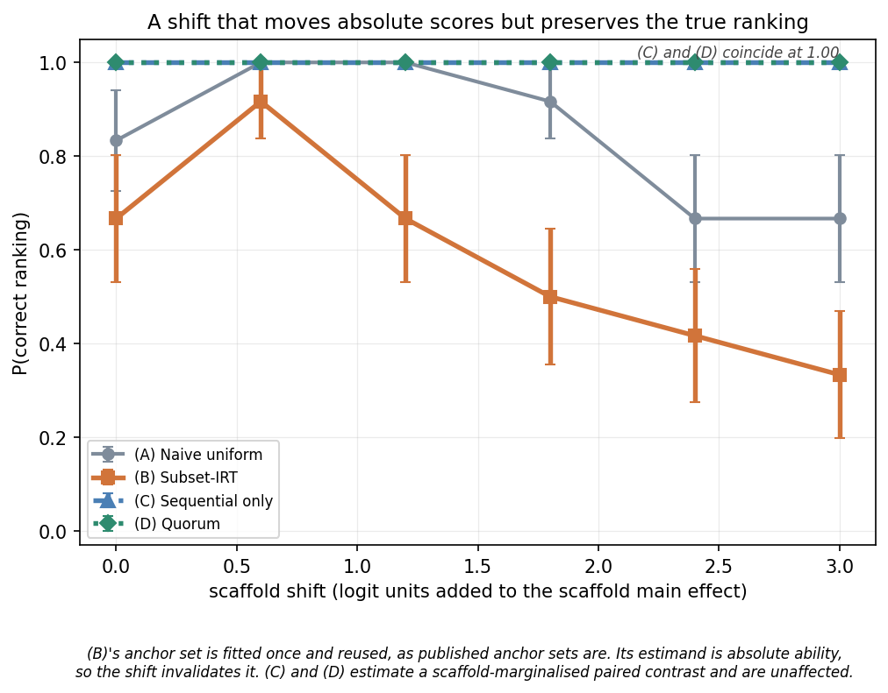
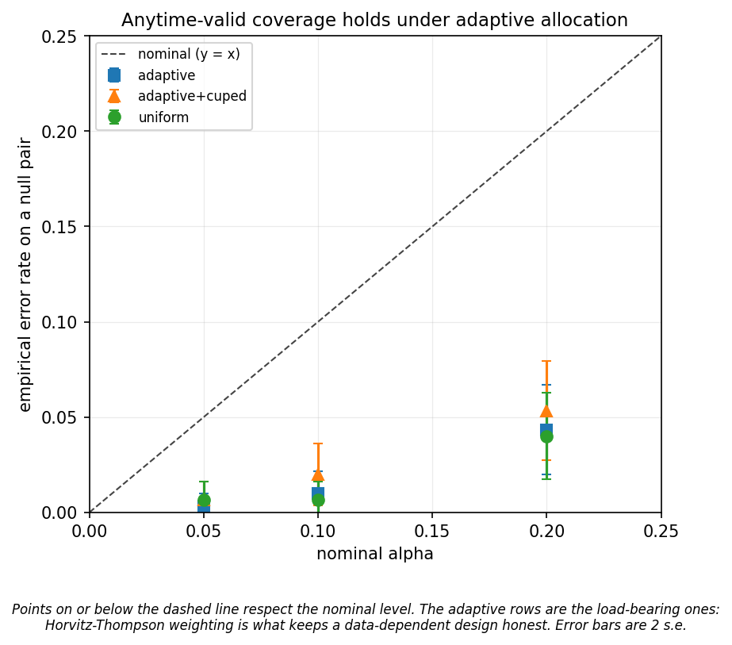

# Quorum

**The decision an evaluation has to make is usually a *ranking*, not a set of scores. Make the ranking the estimand and you can buy the same conclusion far more cheaply — and you find out which comparisons your data never supported in the first place.**

Quorum is a research prototype for rank-targeted **nested sequential experimental design**. It maintains an anytime-valid confidence sequence on model-vs-model contrasts, chooses each next rollout by expected reduction in *rank* uncertainty per dollar, and stops the moment the ordering is certified.

Inference is **design-based and model-assisted**: validity comes from the sampling design (Horvitz–Thompson weighting plus a martingale argument), while a hierarchical Bayesian cell model only steers *where the next rollout goes*. A wrong model costs efficiency, never coverage. That separation is the point of the package.

**Code:** [github.com/NagaYu/quorum](https://github.com/NagaYu/quorum)  ·  **Space:** [huggingface.co/spaces/NagaYu/quorum](https://huggingface.co/spaces/NagaYu/quorum)

## Quickstart

```bash
pip install -e .
quorum compare modelA modelB --benchmark synthetic-easy --budget $50
```

```text
rollouts: 2456   spend: $47.40   wall: 20,964s

[separated]  modelA vs modelB: the interval for the success-rate difference excludes 0
             (Delta in [+0.0039, +0.3799], 95% anytime-valid).
```

Change the benchmark to `synthetic-hard` and it says the other thing — the thing a leaderboard never says:

```text
[indistinguishable at this budget]  A vs B: Delta in [-0.0421, +0.0113] contains 0.
             The data does not support ordering these two.
             Projection (not a guarantee): ~31,974 more paired rollouts.
```

## Method



Four pieces, in the order they matter:

1. **The estimand is a paired, scaffold-marginalised contrast.** `Δ[a,c] = Σ_b w[b]·(p[b,a] − p[b,c])` over blocks `b = (task, seed, scaffold)`. It decomposes as `θ_a − θ_c`, so it is transitive — separating adjacent pairs certifies the whole order. It is also invariant to anything that moves both models equally within a block, which is what makes it survive a scaffold change.
2. **Adaptive allocation stays valid via Horvitz–Thompson.** The allocator picks a block from a predictable `π`; the `w/π` ratio restores the fixed target. `E[Z | F_{i−1}] = Δ` for *any* predictable `π`, and an empirical-Bernstein confidence sequence needs only a bounded sequence with a constant conditional mean — not independence. The exploration floor `π ≥ ε·w` is a statistical requirement, not a heuristic: it is what bounds `w/π ≤ 1/ε`.
3. **Nesting is made safe by an audit subsample.** When the inner rule abandons a rollout, an independent coin sends a fraction `ρ` of firings to completion anyway, and the outcome is reported as `Ỹ = q + (1{audit}/ρ)(X − q)`. Then `E[Ỹ | fired] = E[X | fired]` **for any `q`** — a miscalibrated stopping rule costs variance, never validity.
4. **Control variates must have exactly known means.** Only covariates whose `w`-weighted mean is a closed-form sum over the whole grid are admitted. An estimated mean would inject an `O(n^{-1/2})` bias that a confidence sequence cannot see — during development, a covariate centred on the wrong constant produced a **100% false-positive rate**, which is now a regression test.

## Results

Measured, not asserted. Regenerate with `python -m benchmarks.run` and `python -m benchmarks.figures`; raw CSVs land in `results/`.

### Cost to the same conclusion



Grid `6 tasks x 3 seeds x 3 scaffolds x 4 models`, ability gap 0.45, α = 0.05 family-wise, 12 independent worlds, matched seeds:

| Condition | Rollouts | Spend | Correct ranking | Error guarantee |
|---|---|---|---|---|
| (A) Naive uniform, 1 per cell | 216 | $6.13 | 67% | none |
| (A) Naive uniform, smallest reliable sweep (4/cell) | 864 | $24.43 | 100% | none |
| (B) Subset-IRT (tinyBenchmarks-style) | 632 | $17.72 | 92% (unshifted) | none |
| (C) Sequential only | 6,250 | $173.17 | 100% | anytime-valid, family-wise |
| **(D) Quorum** | **5,258** | **$114.42** | **100%** | anytime-valid, family-wise |

(D) versus (C): **spend −34%**, rollouts −16%. On a separate 10-world paired run the spend saving was significant (Wilcoxon p = 0.007) while the rollout saving was not (p = 0.14). The allocator's criterion is information *per dollar*, so it will trade rollout count for price — the dollar saving is the claim it actually makes, and the rollout count is reported so you can see the trade.

**(A) and (B) are not cheaper than (C)/(D) in a like-for-like sense.** They return a point estimate with no error control; (C) and (D) return a ranking certified at a family-wise level. The honest comparison is within each group, and that is how the figure is labelled.

### Robustness to a scaffold shift



A shift adds to the scaffold main effect: absolute scores move a lot, the true ranking does not. (B)'s anchor set is fitted once and reused, as published anchor sets are.

| Shift (logits) | 0.0 | 0.6 | 1.2 | 1.8 | 2.4 | 3.0 |
|---|---|---|---|---|---|---|
| (A) Naive uniform | 0.83 | 1.00 | 1.00 | 0.92 | 0.67 | 0.67 |
| (B) Subset-IRT | 0.67 | 0.92 | 0.67 | 0.50 | 0.42 | **0.33** |
| (C) Sequential only | 1.00 | 1.00 | 1.00 | 1.00 | 1.00 | 1.00 |
| **(D) Quorum** | **1.00** | **1.00** | **1.00** | **1.00** | **1.00** | **1.00** |

P(correct ranking) over 12 worlds. (B) degrades because its estimand is *absolute ability* read off a frozen anchor set; (C)/(D) estimate a scaffold-marginalised paired contrast and are unaffected.

### Coverage



Null pair (two models with identical ability, so *any* rejection is an error), 300 replications per cell:

| Configuration | α = 0.05 | α = 0.10 | α = 0.20 |
|---|---|---|---|
| Uniform (non-adaptive) | 0.007 | 0.007 | 0.040 |
| **Adaptive allocation** | 0.003 | 0.010 | 0.043 |
| Adaptive + CUPED | 0.007 | 0.020 | 0.053 |

Every cell is at or below nominal, including under adaptive allocation — the case the Horvitz–Thompson construction exists for. A separate 400-replication run at α = 0.10 covering inner truncation and the unpaired regime gave 0.005–0.048, also all below nominal.

One honest caveat: in the 12-world ablation, one world produced a *resolved but incorrect* order for both adaptive configurations (1/12 ≈ 8%). With 12 replications that is well within binomial noise of a 5% rate (P(≥1 error) ≈ 46%); the 300-replication null-pair experiment above is the powered check.

### Variance reduction, honestly

| Regime | Variance ratio (adjusted / raw) | Spend |
|---|---|---|
| Paired design | 1.005 — **no reduction** | $118.02 |
| Unpaired, no control variate | — | $285.46 |
| **Unpaired + control variate** | **0.613** | **$225.73** |

A **negative result worth stating**: under exact pairing, the shared instance difficulty has already cancelled, so a block-level covariate has essentially nothing left to remove. Any covariate symmetric in the two models cannot correlate with their difference to first order. CUPED earns its keep where pairing is impossible — logged data, public leaderboards, models evaluated on differently-sampled subsets — and there it removes about a quarter of the variance.

### Inner truncation

| Audit rate ρ | Steps saved | Rollouts | Spend |
|---|---|---|---|
| 0.3 | 18.9% | 23,029 | $453.49 |
| 0.5 | 13.6% | 11,787 | $246.20 |
| 0.7 | 8.2% | 6,963 | $147.22 |
| 0.9 | 2.8% | 5,961 | $137.55 |
| **off** | 0% | **5,248** | **$118.02** |

Truncation is **off by default**, and that is a measured decision, not an oversight. It genuinely saves trajectory steps and the estimator stays unbiased at every ρ — but the audit reweighting widens the corrected-outcome range from `[0,1]` to `[-q_max(1−ρ)/ρ, 1/ρ]`, and an empirical-Bernstein interval pays for range directly. On this simulator every ρ we swept cost more in total than running rollouts to completion, by 1.2x at ρ = 0.9 rising to 3.8x at ρ = 0.3. Turn it on when trajectory *steps* are your binding cost rather than your rollout count — the trade-off curve is `figures/fig5_truncation.png` so the choice can be made on evidence.

## Claims and where each is verified

| Claim | Verified by | Figure |
|---|---|---|
| Lower cost to the same ranking | `tests/test_efficiency.py` (paired Wilcoxon) | `figures/fig1_cost_to_decision.png` |
| Error rate ≤ nominal, incl. adaptive | `tests/test_coverage.py` (400 null reps) | `figures/fig3_coverage.png` |
| Robust to scaffold shift | `tests/test_simulator.py`, `benchmarks/run.py::run_shift` | `figures/fig2_scaffold_shift.png` |
| Truncation is unbiased even when miscalibrated | `tests/test_truncation_bias.py` | `figures/fig5_truncation.png` |
| Control variate reduces variance | `tests/test_cuped.py` | `figures/fig4_variance_reduction.png` |

Every public function's docstring ends with a `Claim:` line naming which of these it substantiates.

## Use it in your own harness

```python
from quorum.adapters import QuorumSequentialSampler

sampler = QuorumSequentialSampler(tasks=my_tasks, models=["a", "b", "c"])
decision = sampler.run(lambda task, seed, scaffold, model: my_eval_fn(task, seed, scaffold, model))
print(sampler.summary())   # says "NOT established" when it is not
```

`run_fn` may return a `Rollout` or any lighteval-style per-sample dict. `lighteval` need not be installed. `to_lighteval_results(decision, models)` exports a results dict carrying `resolved` and `indistinguishable_pairs`, so a downstream leaderboard can render "we cannot tell these apart".

## What this is not

**This tool does not, and cannot, tell you that one real model is better than another.**

Everything shipped here runs on a synthetic simulator. Model names accepted by the CLI are report captions attached to synthetic indices; no surface in this repository measures, evaluates or ranks a real system, and none produces disparaging language about any specific model.

The Space is built for the opposite purpose: to make statistical **indistinguishability** visible. It highlights in red every pair a dataset does not separate and tells you how much more data the gap would need. On the bundled demo, all 10 pairs are indistinguishable despite visibly different scores — which is the entire point. "Not distinguishable" means *this data cannot tell them apart*; it does not mean the models are equal, and it is not a criticism of either.

## Limitations

- The simulator is synthetic. The scaffold-invariance property is built into the generative model (via a zero scaffold×model interaction), so it demonstrates that the *method* exploits the structure, not that the structure holds for any particular real benchmark.
- The family-wise correction is Bonferroni over all `M(M−1)/2` candidate pairs — honest, because which pairs end up adjacent is data-dependent, but conservative.
- The "additional rollouts" number is a `1/√n` extrapolation. It is a projection, not a guarantee, and it is unreliable when the observed difference is near zero.
- Horvitz–Thompson weighting inflates the per-observation range by up to `1/ε`. Per-observation predictable ranges keep this cheap in practice, but it caps how aggressively the design can concentrate.
- CUPED requires a covariate with an exactly known mean. Trajectory-prefix features of the current rollout do not have one and are deliberately refused; they belong in the truncation `q`-model instead.
- Benchmark numbers come from 10–25 worlds. Differences smaller than roughly 15% should be treated as noise.

## Layout

```
quorum/
  types.py         cells, rollouts, decisions, block flattening
  simulator.py     ground-truth grid, trajectories, costs, instance copula
  loaders.py       replay real logged rollouts through the same API
  cell_model.py    hierarchical partial-pooling model (MAP + Laplace)
  allocator.py     decision-targeted, cost-aware allocation  [contribution b]
  nested_seq.py    confidence sequence, HT channel, truncation + audit  [c]
  cuped.py         known-mean control variates  [d]
  presets.py       named worlds and the one place the pieces get wired
  cli.py           quorum compare / rank / bench / simulate / figures
  adapters/        lighteval-style integration
benchmarks/        the four conditions, the driver, the figures
tests/             coverage, efficiency, truncation bias, CUPED, allocator, CLI
app.py             Gradio Space
scripts/           push rollout-level data to the Hub
SPEC.md            the authoritative math and interface contract
```

## Citation

```bibtex
@software{quorum2026,
  title  = {Quorum: rank-targeted nested sequential design for LLM evaluation},
  author = {Nagao, Yuta},
  year   = {2026},
  url    = {https://github.com/NagaYu/quorum},
  note   = {Research prototype. Apache-2.0.}
}
```
